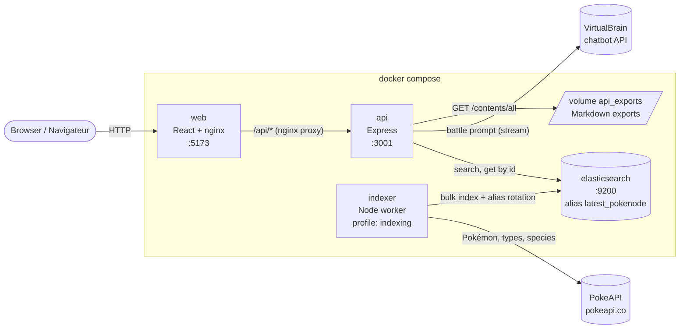

# POKE NODE APP

[English](#english) · [Français](#français)



---

## English

`pokemon-node-app` fetches Pokémon data from [PokeAPI](https://pokeapi.co/api/v2), stores it in Elasticsearch, serves it through an Express API and a React web app, and runs virtual battles narrated by a [VirtualBrain](https://app.getvirtualbrain.com/) chatbot (an LLM).

- [Modules](#modules)
- [Getting started with Docker Compose](#getting-started-with-docker-compose)
- [How-to guides](#how-to-guides)
- [Reference](#reference)
- [Architecture](#architecture)

### Modules

The system has three modules and one datastore, as shown in the diagram above.

| Module | Folder | Role |
|---|---|---|
| Indexer | [indexer/](indexer/) | Worker that fills Elasticsearch from PokeAPI |
| API | [backend/](backend/) | Express API: Pokémon search, Markdown exports, battles |
| Web app | [web-app/](web-app/) | React front: Pokémon grid, search, filters, battle arena |
| Elasticsearch | `docker-compose.yml` | Pokémon store, single node |

#### Indexer

A one-shot Node.js worker (TypeScript, CommonJS). It runs, indexes, and exits.

1. Creates a new index `pokenode_<timestamp>` with its mapping and settings.
2. Reads the Pokémon from PokeAPI in batches of 200, with their types, damage relations (resistances to the 18 types), species and evolution chain.
3. Bulk-indexes each batch, then flushes the index.
4. Rotates the aliases: `latest_pokenode` moves to the new index, `previous_pokenode` to the former one, older indices are deleted.

If indexing fails, the partial index is deleted and the aliases are left untouched: the API keeps serving the previous data.

Stack: `@elastic/elasticsearch`, `ky`, `winston`, `config`. More in [indexer/README.md](indexer/README.md).

#### API (backend)

An Express 5 API in TypeScript. It reads from the `latest_pokenode` alias and talks to the chatbot.

- **Pokémon**: paginated search by name and type, with type facets; get one Pokémon by id.
- **Contents**: converts a Pokémon to Markdown and returns it as a file; exports every Pokémon as Markdown files into the working directory, used to feed the VirtualBrain *brain*.
- **Battles**: builds a battle prompt from 2 to 6 Pokémon, sends it to the chatbot, and streams the narration back as plain text. It handles the API key to token exchange, token refresh, and retries on `429` / `503`.
- Every input is validated with ajv JSON schemas; every error is returned as JSON with a stable `code`.

Stack: `express`, `ajv`, `@elastic/elasticsearch`, `ky`, `json2md`, `config`. Routes, validation and error codes: [backend/README.md](backend/README.md).

#### Web app

A React 18 single-page app in TypeScript, built with Vite and served by nginx.

- Responsive grid of Pokémon cards (image, HP, Attack, Defense, Speed), as cards or as a list.
- Search by name, filter by type, server-side pagination. Page, search and view are kept in the URL.
- Battle selection: pick 2 Pokémon, open the arena (`?view=battle`), read the narration as it is streamed, see the winner in a banner.
- Light and dark themes.

nginx serves the static build and proxies `/api/*` to the API, so the front only uses relative URLs.

Stack: `react`, `@tanstack/react-query`, `ky`, `tailwindcss`, `ts-pattern`. More in [web-app/README.md](web-app/README.md).

### Getting started with Docker Compose

In this section you start the whole stack, fill Elasticsearch, and run your first battle.

#### Prerequisites

- [Docker](https://docs.docker.com/get-docker/) with the Compose plugin (`docker compose version` must work).
- About 2 GB of free memory (Elasticsearch is limited to 1 GB).
- Free ports `3001`, `5173` and `9200`.
- A VirtualBrain chatbot API key (`vb_ak_...`), only needed for battles. See [How to create the VirtualBrain chatbot](#how-to-create-the-virtualbrain-chatbot).

#### 1. Get the code

```sh
git clone <repository-url> pokemon-node-app
cd pokemon-node-app
```

#### 2. Provide the chatbot API key

Create a `.env` file at the root of the repository. Docker Compose reads it automatically, and git ignores it.

```sh
echo "CHATBOT_API_KEY=vb_ak_your_key" > .env
```

Without a key, the stack starts and the grid works, but battles fail with `502 ERR_CHATBOT_UNAVAILABLE`.

#### 3. Start the stack

```sh
docker compose up -d --build
```

This builds the `api` and `web` images and starts `elasticsearch`, `api` and `web`. The API waits until Elasticsearch is healthy, which can take up to a minute.

Check that everything is up:

```sh
docker compose ps
curl http://localhost:3001/ping
```

The last command answers `pong`.

#### 4. Index the Pokémon

The indexer is not started by `up`: it belongs to the `indexing` profile. Run it once:

```sh
docker compose --profile indexing run --build --rm indexer
```

It takes a few minutes and exits when done. Check the result:

```sh
curl "http://localhost:3001/pokemons?size=1"
```

The answer contains one Pokémon and the type facets.

#### 5. Open the web app

Open <http://localhost:5173>. The grid shows the Pokémon. Type a name in the search bar or pick a type to filter them.

#### 6. Run a battle

1. Click **Add to battle** on two Pokémon.
2. Click **Go to the arena** in the bar at the bottom of the page.
3. The narration appears as it is generated, then the winner is shown in a banner.

#### 7. Stop the stack

```sh
docker compose down
```

The indexed data stays in the `esdata` volume. To delete it too, run `docker compose down -v`.

### How-to guides

#### How to re-index the Pokémon

Run the indexer again while the stack is up:

```sh
docker compose --profile indexing run --build --rm indexer
```

The API keeps serving the current index until the new one is complete; then the aliases switch.

#### How to export the Pokémon as Markdown

One Pokémon, downloaded as a file:

```sh
curl -OJ http://localhost:3001/contents/25
```

Every Pokémon, written by the API into its working directory:

```sh
curl http://localhost:3001/contents/all
```

The route answers `202` with a `jobId` and runs the export in the background. The files go to `/app/tmp/<jobId>/` in the `api` container, stored in the `api_exports` volume. Copy them to the host:

```sh
docker compose cp api:/app/tmp/<jobId> ./pokemon-export
```

#### How to create the VirtualBrain chatbot

1. Index the Pokémon and export them as Markdown (see above).
2. Log in to <https://app.getvirtualbrain.com/>, create a *brain* and import the exported folder.
3. Create a chatbot from this brain and generate an API key.
4. Put the key in `.env` (`CHATBOT_API_KEY=...`) and restart the API: `docker compose up -d api`.

API documentation: <https://chatbot-api.getvirtualbrain.com/docs>.

#### How to run a module outside Docker

Each module needs Node.js 26 (see its `.nvmrc`). Keep Elasticsearch running in Docker:

```sh
docker compose up -d elasticsearch
```

Then, in the module folder:

| Module | Commands | Notes |
|---|---|---|
| `backend/` | `npm install` then `npm run dev` | Listens on `3001`. Put the API key in `backend/config/local.json` (ignored by git) or in `CHATBOT_API_KEY`. |
| `indexer/` | `npm install` then `POKE_API_URL=https://pokeapi.co/api/v2 npm run dev` | Runs once and exits. |
| `web-app/` | `npm install` then `npm run dev` | Vite on <http://localhost:5173>, proxies `/api` to `API_PROXY_TARGET` (default `http://localhost:3001`). |

If the `web` container is running, stop it first (`docker compose stop web`) to free port `5173`.

#### How to check a module before committing

In the module folder:

```sh
npm run test
npm run lint
npm run build
npm run prettier
```

### Reference

#### Docker Compose services

| Service | Image / build | Host port | Depends on | Started by `up` |
|---|---|---|---|---|
| `elasticsearch` | `elasticsearch-wolfi:9.5.6` | `127.0.0.1:9200` | none | yes |
| `api` | `./backend` | `3001` | `elasticsearch` healthy | yes |
| `web` | `./web-app` | `5173` (container `8080`) | `api` | yes |
| `indexer` | `./indexer` | none | `elasticsearch` healthy | no, profile `indexing` |

Volumes: `esdata` (Elasticsearch data), `api_exports` (Markdown exports, mounted on `/app/tmp`).

#### Environment variables

**API** (`backend/config/custom-environment-variables.json`)

| Variable | Default | Description |
|---|---|---|
| `PORT` | `3001` | HTTP port |
| `POKE_STORE_URL` | `http://localhost:9200` | Elasticsearch URL |
| `CHATBOT_URL` | `https://chatbot-api.getvirtualbrain.com` | VirtualBrain API URL |
| `CHATBOT_API_KEY` | *(empty)* | Chatbot API key, never commit it |
| `CHATBOT_RETRY_LIMIT` | `3` | Retries on `429` / `503` |
| `CHATBOT_MAX_RETRY_AFTER_MS` | `10000` | Longest `Retry-After` accepted |
| `CHATBOT_BACKOFF_LIMIT_MS` | `5000` | Longest delay between retries without `Retry-After` |
| `WORKING_DIR` | `/tmp` | Folder for `/contents/all` exports (`/app/tmp` in Docker) |

**Indexer** (`indexer/config/custom-environment-variables.json`)

| Variable | Default | Description |
|---|---|---|
| `POKE_STORE_URL` | `http://localhost:9200` | Elasticsearch URL |
| `POKE_API_URL` | none, required | PokeAPI URL, `https://pokeapi.co/api/v2` |

**Web app**

| Variable | Default | Description |
|---|---|---|
| `API_PROXY_TARGET` | `http://localhost:3001` | API URL used by the Vite dev proxy (`npm run dev` only) |

#### API routes

Through the web app, prefix each route with `/api` (for example `http://localhost:5173/api/pokemons`).

| Method | Route | Description |
|---|---|---|
| `GET` | `/ping` | Health check, answers `pong` |
| `GET` | `/pokemons?q=&types=&from=&size=` | Search Pokémon, with type facets |
| `GET` | `/pokemons/:id` | One Pokémon |
| `GET` | `/contents/:pokemonId` | One Pokémon as a Markdown file |
| `GET` | `/contents/all` | Background export of every Pokémon, answers `202` |
| `POST` | `/battles` | Battle of 2 to 6 Pokémon, narration streamed as text |

Parameters, validation rules and error codes: [backend/README.md](backend/README.md).

#### Elasticsearch indices

| Name | Kind | Description |
|---|---|---|
| `pokenode_<timestamp>` | index | One per indexing run |
| `latest_pokenode` | alias | Index read by the API |
| `previous_pokenode` | alias | Former index, kept for a rollback |

#### Module scripts

| Script | backend | indexer | web-app |
|---|---|---|---|
| `dev` | nodemon + ts-node | tsx | Vite |
| `build` | `tsc` | `tsc` | `tsc -b && vite build` |
| `test` | Vitest | Vitest | Vitest + Testing Library + MSW |
| `lint` | ESLint | ESLint | ESLint |
| `prettier` | Prettier | Prettier | Prettier |

### Architecture

#### Layers

Each module follows the same layered model:

| Layer | Responsibility |
|---|---|
| `connectors` | Transport: Elasticsearch client, HTTP clients (`ky`) |
| `repositories` | Data access: build the queries, turn the responses into entities |
| `services` | Orchestration and business logic; throws business errors |
| `controllers` | HTTP (API only): routes, schema validation, parameters, responses |

A layer only calls the one below it. Tests live in `__tests__` folders next to the code and mock the layer just below the tested one.

#### Why the indexer is separate

PokeAPI asks its clients to cache responses. Copying the data once into Elasticsearch means the API never calls PokeAPI at runtime: searches are fast, filters and facets are computed by Elasticsearch, and the app keeps working if PokeAPI is down. The alias rotation lets a new indexing run replace the data with no downtime and keeps the previous index for a rollback.

#### Why the battle is streamed

The LLM writes the narration word by word. The API forwards the chatbot stream as it arrives instead of waiting for the full answer, and the arena displays it in real time. If the browser disconnects, the API aborts the chatbot request.

#### Why nginx proxies the API

The front calls `/api/...`, a relative URL. nginx (in Docker) or Vite (in development) forwards it to the API. The same build works in every environment, with no API URL baked in and no CORS setup.

All architecture decisions are recorded in [ADR.md](ADR.md).

---

## Français

`pokemon-node-app` récupère les données des Pokémon depuis [PokeAPI](https://pokeapi.co/api/v2), les stocke dans Elasticsearch, les expose via une API Express et une application web React, et simule des combats virtuels racontés par un chatbot [VirtualBrain](https://app.getvirtualbrain.com/) (un LLM).

- [Les modules](#les-modules)
- [Démarrer avec Docker Compose](#démarrer-avec-docker-compose)
- [Guides pratiques](#guides-pratiques)
- [Référence](#référence)
- [Architecture logicielle](#architecture-logicielle)

### Les modules

Le système se compose de trois modules et d'un stockage, comme le montre le schéma en haut de page.

| Module | Dossier | Rôle |
|---|---|---|
| Indexer | [indexer/](indexer/) | Worker qui remplit Elasticsearch depuis PokeAPI |
| API | [backend/](backend/) | API Express : recherche de Pokémon, exports Markdown, combats |
| Web app | [web-app/](web-app/) | Front React : grille de Pokémon, recherche, filtres, arène de combat |
| Elasticsearch | `docker-compose.yml` | Stockage des Pokémon, nœud unique |

#### L'indexer

Un worker Node.js ponctuel (TypeScript, CommonJS) : il démarre, indexe, puis s'arrête.

1. Crée un nouvel index `pokenode_<timestamp>` avec son mapping et ses settings.
2. Lit les Pokémon sur PokeAPI par lots de 200, avec leurs types, leurs relations de dégâts (résistances aux 18 types), leur espèce et leur chaîne d'évolution.
3. Indexe chaque lot en bulk, puis flush l'index.
4. Fait tourner les alias : `latest_pokenode` passe sur le nouvel index, `previous_pokenode` sur l'ancien, les index plus anciens sont supprimés.

Si l'indexation échoue, l'index partiel est supprimé et les alias ne bougent pas : l'API continue de servir les données précédentes.

Stack : `@elastic/elasticsearch`, `ky`, `winston`, `config`. Plus de détails dans [indexer/README.md](indexer/README.md).

#### L'API (backend)

Une API Express 5 en TypeScript. Elle lit l'alias `latest_pokenode` et dialogue avec le chatbot.

- **Pokémon** : recherche paginée par nom et par type, avec facettes de types ; lecture d'un Pokémon par id.
- **Contenus** : convertit un Pokémon en Markdown et le renvoie en fichier ; exporte tous les Pokémon en fichiers Markdown dans le dossier de travail, pour alimenter le *brain* VirtualBrain.
- **Combats** : construit un prompt de combat pour 2 à 6 Pokémon, l'envoie au chatbot et renvoie la narration en stream texte. Elle gère l'échange clé d'API / token, le renouvellement du token et les nouvelles tentatives sur `429` / `503`.
- Chaque entrée est validée par des schémas JSON ajv ; chaque erreur est renvoyée en JSON avec un `code` stable.

Stack : `express`, `ajv`, `@elastic/elasticsearch`, `ky`, `json2md`, `config`. Routes, validation et codes d'erreur : [backend/README.md](backend/README.md).

#### L'application web

Une application monopage React 18 en TypeScript, construite avec Vite et servie par nginx.

- Grille responsive de cartes Pokémon (image, PV, Attaque, Défense, Vitesse), en cartes ou en liste.
- Recherche par nom, filtre par type, pagination côté serveur. La page, la recherche et la vue sont conservées dans l'URL.
- Sélection de combat : choisir 2 Pokémon, ouvrir l'arène (`?view=battle`), lire la narration au fil du stream, voir le vainqueur dans un bandeau.
- Thèmes clair et sombre.

nginx sert le build statique et redirige `/api/*` vers l'API : le front n'utilise que des URL relatives.

Stack : `react`, `@tanstack/react-query`, `ky`, `tailwindcss`, `ts-pattern`. Plus de détails dans [web-app/README.md](web-app/README.md).

### Démarrer avec Docker Compose

Dans cette section, vous démarrez toute la stack, remplissez Elasticsearch et lancez votre premier combat.

#### Prérequis

- [Docker](https://docs.docker.com/get-docker/) avec le plugin Compose (`docker compose version` doit fonctionner).
- Environ 2 Go de mémoire libre (Elasticsearch est limité à 1 Go).
- Les ports `3001`, `5173` et `9200` libres.
- Une clé d'API de chatbot VirtualBrain (`vb_ak_...`), nécessaire uniquement pour les combats. Voir [Créer le chatbot VirtualBrain](#créer-le-chatbot-virtualbrain).

#### 1. Récupérer le code

```sh
git clone <url-du-depot> pokemon-node-app
cd pokemon-node-app
```

#### 2. Fournir la clé d'API du chatbot

Créez un fichier `.env` à la racine du dépôt. Docker Compose le lit automatiquement, et git l'ignore.

```sh
echo "CHATBOT_API_KEY=vb_ak_votre_cle" > .env
```

Sans clé, la stack démarre et la grille fonctionne, mais les combats échouent en `502 ERR_CHATBOT_UNAVAILABLE`.

#### 3. Démarrer la stack

```sh
docker compose up -d --build
```

Cette commande construit les images `api` et `web` et démarre `elasticsearch`, `api` et `web`. L'API attend qu'Elasticsearch soit sain, ce qui peut prendre jusqu'à une minute.

Vérifiez que tout tourne :

```sh
docker compose ps
curl http://localhost:3001/ping
```

La dernière commande répond `pong`.

#### 4. Indexer les Pokémon

L'indexer n'est pas démarré par `up` : il appartient au profil `indexing`. Lancez-le une fois :

```sh
docker compose --profile indexing run --build --rm indexer
```

L'indexation prend quelques minutes et le conteneur s'arrête à la fin. Vérifiez le résultat :

```sh
curl "http://localhost:3001/pokemons?size=1"
```

La réponse contient un Pokémon et les facettes de types.

#### 5. Ouvrir l'application web

Ouvrez <http://localhost:5173>. La grille affiche les Pokémon. Tapez un nom dans la barre de recherche ou choisissez un type pour les filtrer.

#### 6. Lancer un combat

1. Cliquez sur **Add to battle** sur deux Pokémon.
2. Cliquez sur **Go to the arena** dans la barre en bas de page.
3. La narration s'affiche au fur et à mesure, puis le vainqueur apparaît dans un bandeau.

#### 7. Arrêter la stack

```sh
docker compose down
```

Les données indexées restent dans le volume `esdata`. Pour les supprimer aussi : `docker compose down -v`.

### Guides pratiques

#### Réindexer les Pokémon

Relancez l'indexer pendant que la stack tourne :

```sh
docker compose --profile indexing run --build --rm indexer
```

L'API continue de servir l'index actuel jusqu'à ce que le nouveau soit complet ; les alias basculent ensuite.

#### Exporter les Pokémon en Markdown

Un Pokémon, téléchargé en fichier :

```sh
curl -OJ http://localhost:3001/contents/25
```

Tous les Pokémon, écrits par l'API dans son dossier de travail :

```sh
curl http://localhost:3001/contents/all
```

La route répond `202` avec un `jobId` et lance l'export en arrière-plan. Les fichiers sont écrits dans `/app/tmp/<jobId>/` du conteneur `api`, stockés dans le volume `api_exports`. Pour les copier sur l'hôte :

```sh
docker compose cp api:/app/tmp/<jobId> ./pokemon-export
```

#### Créer le chatbot VirtualBrain

1. Indexez les Pokémon et exportez-les en Markdown (voir ci-dessus).
2. Connectez-vous sur <https://app.getvirtualbrain.com/>, créez un *brain* et importez le dossier exporté.
3. Créez un chatbot à partir de ce brain et générez une clé d'API.
4. Mettez la clé dans `.env` (`CHATBOT_API_KEY=...`) et redémarrez l'API : `docker compose up -d api`.

Documentation de l'API : <https://chatbot-api.getvirtualbrain.com/docs>.

#### Lancer un module hors Docker

Chaque module demande Node.js 26 (voir son `.nvmrc`). Gardez Elasticsearch dans Docker :

```sh
docker compose up -d elasticsearch
```

Puis, dans le dossier du module :

| Module | Commandes | Notes |
|---|---|---|
| `backend/` | `npm install` puis `npm run dev` | Écoute sur `3001`. Mettez la clé d'API dans `backend/config/local.json` (ignoré par git) ou dans `CHATBOT_API_KEY`. |
| `indexer/` | `npm install` puis `POKE_API_URL=https://pokeapi.co/api/v2 npm run dev` | S'exécute une fois puis s'arrête. |
| `web-app/` | `npm install` puis `npm run dev` | Vite sur <http://localhost:5173>, redirige `/api` vers `API_PROXY_TARGET` (par défaut `http://localhost:3001`). |

Si le conteneur `web` tourne, arrêtez-le d'abord (`docker compose stop web`) pour libérer le port `5173`.

#### Vérifier un module avant de commiter

Dans le dossier du module :

```sh
npm run test
npm run lint
npm run build
npm run prettier
```

### Référence

#### Services Docker Compose

| Service | Image / build | Port hôte | Dépend de | Démarré par `up` |
|---|---|---|---|---|
| `elasticsearch` | `elasticsearch-wolfi:9.5.6` | `127.0.0.1:9200` | aucun | oui |
| `api` | `./backend` | `3001` | `elasticsearch` sain | oui |
| `web` | `./web-app` | `5173` (conteneur `8080`) | `api` | oui |
| `indexer` | `./indexer` | aucun | `elasticsearch` sain | non, profil `indexing` |

Volumes : `esdata` (données Elasticsearch), `api_exports` (exports Markdown, monté sur `/app/tmp`).

#### Variables d'environnement

**API** (`backend/config/custom-environment-variables.json`)

| Variable | Défaut | Description |
|---|---|---|
| `PORT` | `3001` | Port HTTP |
| `POKE_STORE_URL` | `http://localhost:9200` | URL d'Elasticsearch |
| `CHATBOT_URL` | `https://chatbot-api.getvirtualbrain.com` | URL de l'API VirtualBrain |
| `CHATBOT_API_KEY` | *(vide)* | Clé d'API du chatbot, à ne jamais commiter |
| `CHATBOT_RETRY_LIMIT` | `3` | Nouvelles tentatives sur `429` / `503` |
| `CHATBOT_MAX_RETRY_AFTER_MS` | `10000` | `Retry-After` le plus long accepté |
| `CHATBOT_BACKOFF_LIMIT_MS` | `5000` | Délai maximal entre deux tentatives sans `Retry-After` |
| `WORKING_DIR` | `/tmp` | Dossier des exports `/contents/all` (`/app/tmp` dans Docker) |

**Indexer** (`indexer/config/custom-environment-variables.json`)

| Variable | Défaut | Description |
|---|---|---|
| `POKE_STORE_URL` | `http://localhost:9200` | URL d'Elasticsearch |
| `POKE_API_URL` | aucun, obligatoire | URL de PokeAPI, `https://pokeapi.co/api/v2` |

**Web app**

| Variable | Défaut | Description |
|---|---|---|
| `API_PROXY_TARGET` | `http://localhost:3001` | URL de l'API pour le proxy Vite (`npm run dev` uniquement) |

#### Routes de l'API

Depuis l'application web, préfixez chaque route par `/api` (par exemple `http://localhost:5173/api/pokemons`).

| Méthode | Route | Description |
|---|---|---|
| `GET` | `/ping` | Vérification de santé, répond `pong` |
| `GET` | `/pokemons?q=&types=&from=&size=` | Recherche de Pokémon, avec facettes de types |
| `GET` | `/pokemons/:id` | Un Pokémon |
| `GET` | `/contents/:pokemonId` | Un Pokémon en fichier Markdown |
| `GET` | `/contents/all` | Export en arrière-plan de tous les Pokémon, répond `202` |
| `POST` | `/battles` | Combat de 2 à 6 Pokémon, narration en stream texte |

Paramètres, règles de validation et codes d'erreur : [backend/README.md](backend/README.md).

#### Index Elasticsearch

| Nom | Type | Description |
|---|---|---|
| `pokenode_<timestamp>` | index | Un par exécution de l'indexer |
| `latest_pokenode` | alias | Index lu par l'API |
| `previous_pokenode` | alias | Index précédent, conservé pour un retour arrière |

#### Scripts des modules

| Script | backend | indexer | web-app |
|---|---|---|---|
| `dev` | nodemon + ts-node | tsx | Vite |
| `build` | `tsc` | `tsc` | `tsc -b && vite build` |
| `test` | Vitest | Vitest | Vitest + Testing Library + MSW |
| `lint` | ESLint | ESLint | ESLint |
| `prettier` | Prettier | Prettier | Prettier |

### Architecture logicielle

#### Les couches

Chaque module suit le même modèle en couches :

| Couche | Responsabilité |
|---|---|
| `connectors` | Transport : client Elasticsearch, clients HTTP (`ky`) |
| `repositories` | Accès aux données : construction des requêtes, transformation des réponses en entités |
| `services` | Orchestration et logique applicative ; lève les erreurs métier |
| `controllers` | HTTP (API uniquement) : routes, validation des schémas, paramètres, réponses |

Une couche n'appelle que celle du dessous. Les tests sont dans des dossiers `__tests__` à côté du code et mockent la couche juste en dessous du module testé.

#### Pourquoi un indexer séparé

PokeAPI demande à ses clients de mettre ses réponses en cache. Copier les données une fois dans Elasticsearch évite à l'API d'appeler PokeAPI à l'exécution : les recherches sont rapides, les filtres et les facettes sont calculés par Elasticsearch, et l'application fonctionne même si PokeAPI est indisponible. La rotation des alias permet à une nouvelle indexation de remplacer les données sans interruption et garde l'index précédent pour un retour arrière.

#### Pourquoi le combat est streamé

Le LLM écrit la narration mot après mot. L'API relaie le stream du chatbot au fil de l'eau au lieu d'attendre la réponse complète, et l'arène l'affiche en temps réel. Si le navigateur se déconnecte, l'API annule la requête au chatbot.

#### Pourquoi nginx relaie l'API

Le front appelle `/api/...`, une URL relative. nginx (dans Docker) ou Vite (en développement) la redirige vers l'API. Le même build fonctionne dans tous les environnements, sans URL d'API figée et sans configuration CORS.

Toutes les décisions d'architecture sont consignées dans [ADR.md](ADR.md).
