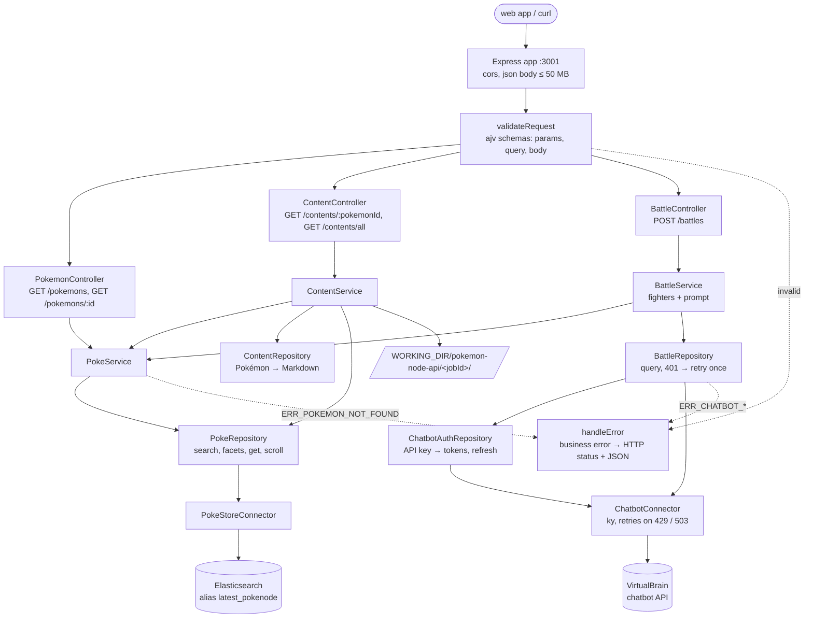
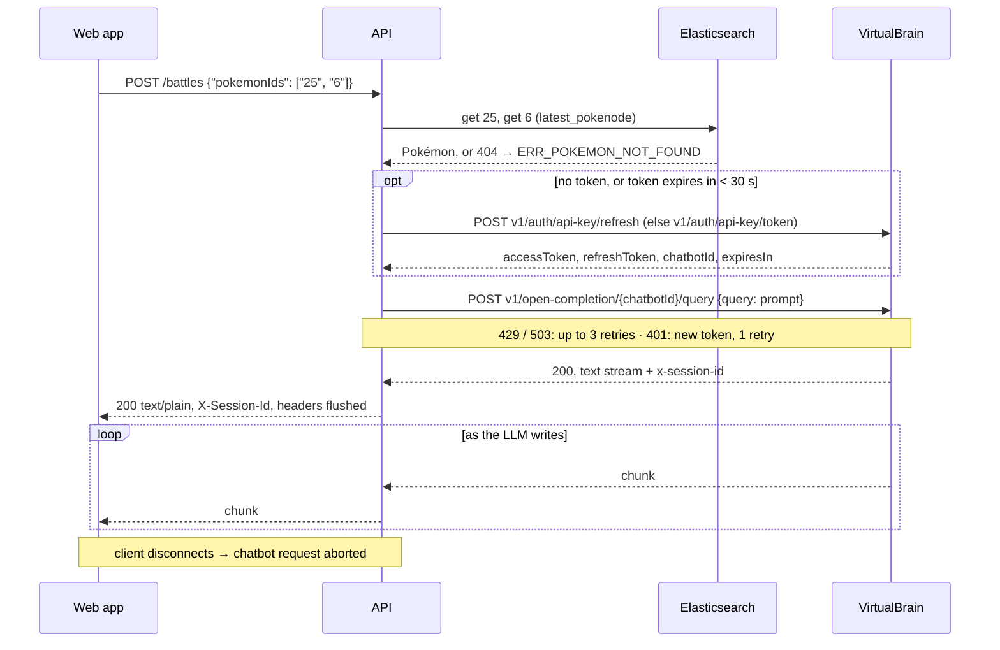

# API (backend)

[English](#english) · [Français](#français) · [Project README](../README.md)





---

## English

The API is an Express 5 server in TypeScript. It reads the Pokémon indexed by the [indexer](../indexer/README.md) in Elasticsearch, exports them as Markdown, and runs battles by streaming the narration of the VirtualBrain chatbot. The [web app](../web-app/README.md) calls it through `/api`.

- [How it works](#how-it-works)
- [Run the API](#run-the-api)
- [Reference](#reference)
- [How-to guides](#how-to-guides)
- [Design choices](#design-choices)

### How it works

The first diagram shows the layers; the second, a battle.

Every request goes through `validateRequest`, which checks params, query and body against an ajv schema, converts them (`"5"` → `5`) and applies defaults. The controller reads the result from `res.locals.validated`, calls a service, and sends the answer. Any error, thrown anywhere, reaches `handleError`, which turns it into a status and a JSON body.

#### Search

`GET /pokemons` builds one Elasticsearch query on the `latest_pokenode` alias:

- with `q`: a fuzzy match on `name` (boost 2) or a prefix match on `name.autocomplete`; results sorted by score, then id;
- without `q`: every Pokémon, sorted by id;
- `types`: a `post_filter` keeping Pokémon that have **at least one** of the types;
- the type facets are computed on the `q` results, **before** the type filter, so the counts don't change when you tick a type. A selected type absent from the results still appears, with a count of 0.

Only the fields needed by the grid are returned (`id`, `pokedexId`, `name`, `image`, `sprite`, `stats`, `apiTypes`). `GET /pokemons/:id` returns the full document.

#### Markdown exports

`ContentRepository` writes a Pokémon as Markdown with `json2md`: a title, then three lists (presentation, stats, characteristics including types, generation, evolutions and resistances).

- `GET /contents/:pokemonId` streams this file as an attachment, `contents-pokemon-<id>.md`.
- `GET /contents/all` answers `202` right away with a `jobId`, then reads every Pokémon with a scroll (200 at a time) and writes one file each into `WORKING_DIR/pokemon-node-api/<jobId>/`. These files are the source of the VirtualBrain *brain*.

#### Battles

1. `BattleService` reads the 2 to 6 Pokémon in parallel. Missing ones are collected and reported together in one `404`.
2. It writes a French prompt: tell the battle turn by turn, pick the winner among the fighters, end with a line `Vainqueur : <name> (#<id>)`. The web app reads that line to show the winner.
3. `ChatbotAuthRepository` gives a valid access token (see [Chatbot authentication](#chatbot-authentication)).
4. `BattleRepository` sends the prompt. The chatbot answer is not read: its body is piped as is to the client, with the headers flushed first, so the narration appears as it is written.
5. If the client disconnects, the chatbot request is aborted. If the chatbot stream breaks once started, the error is logged and the connection is cut (the status is already sent).

### Run the API

#### With Docker Compose

From the root of the repository, with `CHATBOT_API_KEY` in `.env`:

```sh
docker compose up -d --build api
```

Compose also starts `elasticsearch` and waits until it is healthy. Then:

```sh
curl http://localhost:3001/ping
```

answers `pong`. Searches return nothing until the Pokémon are indexed: see the [indexer](../indexer/README.md).

In the image, `config/local.json` is not copied (see `.dockerignore`): all settings come from `default.json` and the environment set in [docker-compose.yml](../docker-compose.yml).

#### Without Docker

Requires Node.js 26 (see [.nvmrc](.nvmrc)) and a reachable Elasticsearch:

```sh
docker compose up -d elasticsearch
```

Put the chatbot key in `config/local.json` (ignored by git):

```json
{
    "connectors": {
        "chatbot": { "apiKey": "vb_ak_..." }
    }
}
```

or export `CHATBOT_API_KEY`. Then, in `backend/`:

```sh
npm install
npm run dev
```

`npm run dev` runs `src/app.ts` with `ts-node` under `nodemon`, restarting on each change. The API listens on <http://localhost:3001>. Stop the `api` container first (`docker compose stop api`) if it holds the port.

To run the compiled version:

```sh
npm run build
node dist/app.js
```

#### Check the code

```sh
npm run test
npm run lint
npm run build
npm run prettier
```

### Reference

#### Routes

| Method | Route | Input | Success |
|---|---|---|---|
| `GET` | `/ping` | none | `200` `pong` |
| `GET` | `/pokemons` | query `q`, `types`, `from`, `size` | `200` `{ "pokemons": { from, size, total, items, filters } }` |
| `GET` | `/pokemons/:id` | param `id` | `200` `{ "pokemon": { ... } }` |
| `GET` | `/contents/:pokemonId` | param `pokemonId` | `200` `application/octet-stream`, `contents-pokemon-<id>.md` |
| `GET` | `/contents/all` | none | `202` `{ "job": "PokemonExport", "jobId": "<uuid>" }` |
| `POST` | `/battles` | body `{ "pokemonIds": [...] }` | `200` `text/plain; charset=utf-8` stream |

Examples:

```sh
curl "http://localhost:3001/pokemons?q=pika&types=electric&size=5"
curl http://localhost:3001/pokemons/25
curl -OJ http://localhost:3001/contents/25
curl -N -X POST http://localhost:3001/battles \
  -H "Content-Type: application/json" \
  -d '{"pokemonIds": ["25", "6"]}'
```

`filters` in the search answer is a list of `{ "name": "<type>", "count": <n> }`.

`POST /battles` answer headers: `Cache-Control: no-cache`, `X-Accel-Buffering: no` (no proxy buffering), and `X-Session-Id` with the chatbot session id, when the chatbot sends one, for follow-up questions.

#### Request validation

| Route | Input | Rules |
|---|---|---|
| `GET /pokemons` | query | `q`: at most 100 characters; `types`: 1 to 18 distinct, non blank values (`?types=fire&types=water`); `from`: integer ≥ 0, default `0`; `size`: integer from 1 to 100, default `20`; no other parameter |
| `GET /pokemons/:id` | params | `id`: positive integer, no leading zero |
| `GET /contents/:pokemonId` | params | `pokemonId`: positive integer, no leading zero |
| `POST /battles` | body | `pokemonIds`: 2 to 6 distinct ids, as strings or integers; no other key |

Query strings are converted (`size=5` becomes `5`, a single `types` becomes an array) and defaults applied. Invalid input is rejected with `400 ERR_INVALID_REQUEST`, listing every problem at once.

#### Errors

All errors are JSON, built by the `handleError` middleware from the error thrown by the services:

```json
{
  "code": "ERR_INVALID_REQUEST",
  "message": "Request validation failed",
  "value": null,
  "validationErrors": [
    { "location": "query", "path": "/size", "keyword": "maximum", "message": "must be <= 100" }
  ]
}
```

| Status | `code` | Routes | When |
|---|---|---|---|
| 400 | `ERR_INVALID_REQUEST` | all | Invalid params, query or body |
| 404 | `ERR_POKEMON_NOT_FOUND` | `/pokemons/:id`, `/contents/:pokemonId`, `/battles` | Unknown Pokémon; `value` lists their ids |
| 429 | `ERR_CHATBOT_RATE_LIMITED` | `/battles` | Chatbot rate limit after the retries; `value` and `Retry-After` give the wait in seconds |
| 502 | `ERR_CHATBOT_UNAVAILABLE` | `/battles` | The chatbot answered with another error |
| 500 | `ERR_INTERNAL` | all | Any other error, logged by the server |

- `validationErrors` is only present on `ERR_INVALID_REQUEST`. `location` is `params`, `query` or `body`, and `path` is a JSON Pointer to the invalid value.
- A body Express cannot read (malformed JSON, too large) also answers `ERR_INVALID_REQUEST`, with the Express status (`400`, `413`, `415`).

#### Configuration

Read with [`config`](https://github.com/node-config/node-config) from `config/default.json`, overridden by `config/local.json` and the environment variables below.

| Variable | Config key | Default | Description |
|---|---|---|---|
| `PORT` | `webserver.port` | `3001` | HTTP port |
| `POKE_STORE_URL` | `connectors.pokeStore.url` | `http://localhost:9200` | Elasticsearch URL |
| `CHATBOT_URL` | `connectors.chatbot.url` | `https://chatbot-api.getvirtualbrain.com` | VirtualBrain API URL |
| `CHATBOT_API_KEY` | `connectors.chatbot.apiKey` | *(empty)* | API key (`vb_ak_...`), never commit it |
| `CHATBOT_RETRY_LIMIT` | `settings.chatbotRetry.limit` | `3` | Retries on `429` / `503` |
| `CHATBOT_MAX_RETRY_AFTER_MS` | `settings.chatbotRetry.maxRetryAfterMs` | `10000` | Longest `Retry-After` wait accepted; beyond it, give up at once |
| `CHATBOT_BACKOFF_LIMIT_MS` | `settings.chatbotRetry.backoffLimitMs` | `5000` | Longest delay between retries without `Retry-After` |
| `WORKING_DIR` | `settings.workingDir` | `/tmp` | Base folder of the exports; files go to `<WORKING_DIR>/pokemon-node-api/<jobId>/` |

In Docker Compose, `WORKING_DIR=/app/tmp`, mounted on the `api_exports` volume.

#### Chatbot authentication

| Step | Call | When |
|---|---|---|
| Exchange | `POST v1/auth/api-key/token` `{ apiKey }` | First battle, or refresh failed |
| Refresh | `POST v1/auth/api-key/refresh` `{ refreshToken, chatbotId }` | Token expires in less than 30 s |
| Query | `POST v1/open-completion/{chatbotId}/query` `{ query }`, `Authorization: Bearer <accessToken>` | Each battle |

The tokens and the `chatbotId` come from the exchange and are kept in memory. Concurrent battles share a single exchange or refresh. If a query gets `401`, the token is dropped and the query is sent once more with a new one.

#### Source layout

| Path | Layer | Role |
|---|---|---|
| `src/app.ts` | entry point | Express app, middlewares, routes, `/ping`, `handleError` |
| `src/config.ts` | | Typed configuration |
| `src/constants.ts` | | Limits, patterns, winner label, token margin |
| `src/controllers/` | controllers | `PokemonController`, `ContentsController`, `BattleController` |
| `src/controllers/schemas/` | controllers | ajv schemas per route |
| `src/controllers/middlewares/` | controllers | `validateRequest`, `handleError` |
| `src/services/` | services | `PokeService`, `ContentService`, `BattleService` |
| `src/repositories/` | repositories | `PokeRepository`, `ContentRepository`, `BattleRepository`, `ChatbotAuthRepository` |
| `src/connectors/` | connectors | `PokeStoreConnector` (Elasticsearch, scroll), `ChatbotConnector` (`ky`, retries, session header) |
| `src/entities/` | entities | `Pokemon`, `PokemonTypeFacet` |
| `src/errors/` | errors | Business errors; `http/` for request and internal errors |
| `src/types/` | types | Shared `.d.ts` types |

Tests sit in `__tests__` folders next to the code (Vitest, supertest for the controllers). Each test mocks the layer just below the tested one.

### How-to guides

#### How to validate a new route

Add a schema in `src/controllers/schemas/` and declare it with `validateRequest`. The controller reads the converted values from `res.locals.validated`:

```ts
PokemonController.get(
    "/:id",
    validateRequest({ params: pokemonIdParamsSchema }),
    async (_req: Request, res: Response<unknown, ValidatedLocals<PokemonIdParams>>) => {
        const { id } = res.locals.validated.params;
        // ...
    },
);
```

#### How to add an error

1. Create a class in `src/errors/` implementing `ServiceErrorInterface`, with its own `code` and `value`.
2. Throw it from a service.
3. Map it to a status in `toWebserverError` (`src/controllers/middlewares/handleError.ts`).

#### How to get the exported files

```sh
curl http://localhost:3001/contents/all
docker compose cp api:/app/tmp/pokemon-node-api/<jobId> ./pokemon-export
```

The route does not report progress: the export is done when the folder holds one file per indexed Pokémon.

### Design choices

**Validation at the door.** Every input is checked by an ajv schema before the controller, and every problem is reported at once. Controllers and services get typed, converted values and never re-check them.

**Business errors, HTTP at the edge.** Services throw errors that carry a `code` and a `value` but no status. Only `handleError` knows HTTP: it maps each error to a status, so the services stay usable outside Express.

**Raw stream proxy for battles.** The API does not parse the narration: it pipes the chatbot body to the client. The first words show up as soon as the LLM writes them, memory use stays flat, and aborting on disconnect stops the chatbot from working for nobody.

**Authentication in its own repository.** The token cycle (exchange, refresh, fallback, sharing between concurrent requests, retry on `401`) lives in `ChatbotAuthRepository`; `BattleRepository` only asks for a valid token.

**Facets before the type filter.** Using a `post_filter` for types means the facet counts describe the name search, not the current selection, so the user can tick several types without the others disappearing.

More context in [ADR-010](../ADR.md#adr-010--facettes-construites-par-lapi), [ADR-014](../ADR.md#adr-014--route-post-battles--proxy-brut-du-stream-du-chatbot), [ADR-015](../ADR.md#adr-015--le-chatbotid-est-fourni-par-léchange-de-la-clé-dapi), [ADR-017](../ADR.md#adr-017--validation-des-requêtes-avec-ajv), [ADR-018](../ADR.md#adr-018--erreurs-métier-converties-en-erreurs-http-par-handleerror) and [ADR-019](../ADR.md#adr-019--authentification-du-chatbot-isolée-dans-chatbotauthrepository).

---

## Français

L'API est un serveur Express 5 en TypeScript. Elle lit dans Elasticsearch les Pokémon indexés par l'[indexer](../indexer/README.md), les exporte en Markdown, et lance des combats en relayant en stream la narration du chatbot VirtualBrain. L'[application web](../web-app/README.md) l'appelle via `/api`.

- [Principe de fonctionnement](#principe-de-fonctionnement)
- [Lancer l'API](#lancer-lapi)
- [Référence technique](#référence-technique)
- [Guides pratiques](#guides-pratiques)
- [Choix de conception](#choix-de-conception)

### Principe de fonctionnement

Le premier schéma montre les couches ; le second, un combat.

Chaque requête passe par `validateRequest`, qui vérifie params, query et body avec un schéma ajv, les convertit (`"5"` → `5`) et applique les valeurs par défaut. Le contrôleur lit le résultat dans `res.locals.validated`, appelle un service et envoie la réponse. Toute erreur, d'où qu'elle vienne, arrive dans `handleError`, qui la transforme en statut et en corps JSON.

#### Recherche

`GET /pokemons` construit une seule requête Elasticsearch sur l'alias `latest_pokenode` :

- avec `q` : une recherche floue sur `name` (boost 2) ou par préfixe sur `name.autocomplete` ; résultats triés par score, puis par id ;
- sans `q` : tous les Pokémon, triés par id ;
- `types` : un `post_filter` qui garde les Pokémon ayant **au moins un** des types ;
- les facettes de types sont calculées sur les résultats de `q`, **avant** le filtre de type : les compteurs ne changent pas quand on coche un type. Un type sélectionné absent des résultats apparaît quand même, avec un compteur à 0.

Seuls les champs utiles à la grille sont renvoyés (`id`, `pokedexId`, `name`, `image`, `sprite`, `stats`, `apiTypes`). `GET /pokemons/:id` renvoie le document complet.

#### Exports Markdown

`ContentRepository` écrit un Pokémon en Markdown avec `json2md` : un titre, puis trois listes (présentation, statistiques, caractéristiques dont types, génération, évolutions et résistances).

- `GET /contents/:pokemonId` renvoie ce fichier en stream, en pièce jointe, `contents-pokemon-<id>.md`.
- `GET /contents/all` répond tout de suite `202` avec un `jobId`, puis lit tous les Pokémon par scroll (200 par 200) et écrit un fichier par Pokémon dans `WORKING_DIR/pokemon-node-api/<jobId>/`. Ces fichiers sont la source du *brain* VirtualBrain.

#### Combats

1. `BattleService` lit les 2 à 6 Pokémon en parallèle. Les absents sont regroupés et signalés ensemble dans un seul `404`.
2. Il rédige un prompt en français : raconter le combat tour par tour, choisir le vainqueur parmi les combattants, terminer par une ligne `Vainqueur : <nom> (#<id>)`. L'application web lit cette ligne pour afficher le vainqueur.
3. `ChatbotAuthRepository` fournit un token d'accès valide (voir [Authentification du chatbot](#authentification-du-chatbot)).
4. `BattleRepository` envoie le prompt. La réponse du chatbot n'est pas lue : son corps est relayé tel quel au client, après envoi immédiat des en-têtes, pour que la narration s'affiche au fil de l'écriture.
5. Si le client se déconnecte, la requête au chatbot est annulée. Si le stream du chatbot casse en cours de route, l'erreur est journalisée et la connexion coupée (le statut est déjà parti).

### Lancer l'API

#### Avec Docker Compose

Depuis la racine du dépôt, avec `CHATBOT_API_KEY` dans `.env` :

```sh
docker compose up -d --build api
```

Compose démarre aussi `elasticsearch` et attend qu'il soit sain. Ensuite :

```sh
curl http://localhost:3001/ping
```

répond `pong`. Les recherches ne renvoient rien tant que les Pokémon ne sont pas indexés : voir l'[indexer](../indexer/README.md).

Dans l'image, `config/local.json` n'est pas copié (voir `.dockerignore`) : tous les réglages viennent de `default.json` et de l'environnement défini dans [docker-compose.yml](../docker-compose.yml).

#### Sans Docker

Nécessite Node.js 26 (voir [.nvmrc](.nvmrc)) et un Elasticsearch joignable :

```sh
docker compose up -d elasticsearch
```

Mettez la clé du chatbot dans `config/local.json` (ignoré par git) :

```json
{
    "connectors": {
        "chatbot": { "apiKey": "vb_ak_..." }
    }
}
```

ou exportez `CHATBOT_API_KEY`. Puis, dans `backend/` :

```sh
npm install
npm run dev
```

`npm run dev` exécute `src/app.ts` avec `ts-node` sous `nodemon`, qui redémarre à chaque modification. L'API écoute sur <http://localhost:3001>. Arrêtez d'abord le conteneur `api` (`docker compose stop api`) s'il occupe le port.

Pour exécuter la version compilée :

```sh
npm run build
node dist/app.js
```

#### Vérifier le code

```sh
npm run test
npm run lint
npm run build
npm run prettier
```

### Référence technique

#### Routes

| Méthode | Route | Entrée | Succès |
|---|---|---|---|
| `GET` | `/ping` | aucune | `200` `pong` |
| `GET` | `/pokemons` | query `q`, `types`, `from`, `size` | `200` `{ "pokemons": { from, size, total, items, filters } }` |
| `GET` | `/pokemons/:id` | param `id` | `200` `{ "pokemon": { ... } }` |
| `GET` | `/contents/:pokemonId` | param `pokemonId` | `200` `application/octet-stream`, `contents-pokemon-<id>.md` |
| `GET` | `/contents/all` | aucune | `202` `{ "job": "PokemonExport", "jobId": "<uuid>" }` |
| `POST` | `/battles` | body `{ "pokemonIds": [...] }` | `200` stream `text/plain; charset=utf-8` |

Exemples :

```sh
curl "http://localhost:3001/pokemons?q=pika&types=electric&size=5"
curl http://localhost:3001/pokemons/25
curl -OJ http://localhost:3001/contents/25
curl -N -X POST http://localhost:3001/battles \
  -H "Content-Type: application/json" \
  -d '{"pokemonIds": ["25", "6"]}'
```

Dans la réponse de recherche, `filters` est une liste de `{ "name": "<type>", "count": <n> }`.

En-têtes de la réponse de `POST /battles` : `Cache-Control: no-cache`, `X-Accel-Buffering: no` (pas de mise en tampon par un proxy), et `X-Session-Id` avec l'id de session du chatbot, quand celui-ci en envoie un, pour des questions de suivi.

#### Validation des requêtes

| Route | Entrée | Règles |
|---|---|---|
| `GET /pokemons` | query | `q` : 100 caractères au plus ; `types` : 1 à 18 valeurs distinctes, non vides (`?types=fire&types=water`) ; `from` : entier ≥ 0, `0` par défaut ; `size` : entier de 1 à 100, `20` par défaut ; aucun autre paramètre |
| `GET /pokemons/:id` | params | `id` : entier positif, sans zéro en tête |
| `GET /contents/:pokemonId` | params | `pokemonId` : entier positif, sans zéro en tête |
| `POST /battles` | body | `pokemonIds` : 2 à 6 ids distincts, en chaînes ou en entiers ; aucune autre clé |

Les query strings sont converties (`size=5` devient `5`, un `types` seul devient un tableau) et les valeurs par défaut appliquées. Une entrée invalide est rejetée en `400 ERR_INVALID_REQUEST`, avec la liste de tous les problèmes d'un coup.

#### Erreurs

Toutes les erreurs sont en JSON, construites par le middleware `handleError` à partir de l'erreur levée par les services :

```json
{
  "code": "ERR_INVALID_REQUEST",
  "message": "Request validation failed",
  "value": null,
  "validationErrors": [
    { "location": "query", "path": "/size", "keyword": "maximum", "message": "must be <= 100" }
  ]
}
```

| Statut | `code` | Routes | Quand |
|---|---|---|---|
| 400 | `ERR_INVALID_REQUEST` | toutes | Params, query ou body invalides |
| 404 | `ERR_POKEMON_NOT_FOUND` | `/pokemons/:id`, `/contents/:pokemonId`, `/battles` | Pokémon inconnu ; `value` liste leurs ids |
| 429 | `ERR_CHATBOT_RATE_LIMITED` | `/battles` | Limite de débit du chatbot après les nouvelles tentatives ; `value` et `Retry-After` donnent l'attente en secondes |
| 502 | `ERR_CHATBOT_UNAVAILABLE` | `/battles` | Le chatbot a répondu par une autre erreur |
| 500 | `ERR_INTERNAL` | toutes | Toute autre erreur, journalisée par le serveur |

- `validationErrors` n'est présent que sur `ERR_INVALID_REQUEST`. `location` vaut `params`, `query` ou `body`, et `path` est un JSON Pointer vers la valeur invalide.
- Un corps qu'Express ne sait pas lire (JSON mal formé, trop gros) répond aussi `ERR_INVALID_REQUEST`, avec le statut d'Express (`400`, `413`, `415`).

#### Configuration

Lue avec [`config`](https://github.com/node-config/node-config) depuis `config/default.json`, surchargée par `config/local.json` et par les variables d'environnement ci-dessous.

| Variable | Clé de config | Défaut | Description |
|---|---|---|---|
| `PORT` | `webserver.port` | `3001` | Port HTTP |
| `POKE_STORE_URL` | `connectors.pokeStore.url` | `http://localhost:9200` | URL d'Elasticsearch |
| `CHATBOT_URL` | `connectors.chatbot.url` | `https://chatbot-api.getvirtualbrain.com` | URL de l'API VirtualBrain |
| `CHATBOT_API_KEY` | `connectors.chatbot.apiKey` | *(vide)* | Clé d'API (`vb_ak_...`), à ne jamais commiter |
| `CHATBOT_RETRY_LIMIT` | `settings.chatbotRetry.limit` | `3` | Nouvelles tentatives sur `429` / `503` |
| `CHATBOT_MAX_RETRY_AFTER_MS` | `settings.chatbotRetry.maxRetryAfterMs` | `10000` | Attente `Retry-After` maximale acceptée ; au-delà, abandon immédiat |
| `CHATBOT_BACKOFF_LIMIT_MS` | `settings.chatbotRetry.backoffLimitMs` | `5000` | Délai maximal entre deux tentatives sans `Retry-After` |
| `WORKING_DIR` | `settings.workingDir` | `/tmp` | Dossier de base des exports ; les fichiers vont dans `<WORKING_DIR>/pokemon-node-api/<jobId>/` |

Dans Docker Compose, `WORKING_DIR=/app/tmp`, monté sur le volume `api_exports`.

#### Authentification du chatbot

| Étape | Appel | Quand |
|---|---|---|
| Échange | `POST v1/auth/api-key/token` `{ apiKey }` | Premier combat, ou échec du renouvellement |
| Renouvellement | `POST v1/auth/api-key/refresh` `{ refreshToken, chatbotId }` | Le token expire dans moins de 30 s |
| Requête | `POST v1/open-completion/{chatbotId}/query` `{ query }`, `Authorization: Bearer <accessToken>` | Chaque combat |

Les tokens et le `chatbotId` viennent de l'échange et sont gardés en mémoire. Des combats simultanés partagent un seul échange ou renouvellement. Si une requête reçoit un `401`, le token est abandonné et la requête est renvoyée une fois avec un nouveau token.

#### Organisation du code

| Chemin | Couche | Rôle |
|---|---|---|
| `src/app.ts` | point d'entrée | App Express, middlewares, routes, `/ping`, `handleError` |
| `src/config.ts` | | Configuration typée |
| `src/constants.ts` | | Limites, patterns, libellé du vainqueur, marge des tokens |
| `src/controllers/` | controllers | `PokemonController`, `ContentsController`, `BattleController` |
| `src/controllers/schemas/` | controllers | Schémas ajv par route |
| `src/controllers/middlewares/` | controllers | `validateRequest`, `handleError` |
| `src/services/` | services | `PokeService`, `ContentService`, `BattleService` |
| `src/repositories/` | repositories | `PokeRepository`, `ContentRepository`, `BattleRepository`, `ChatbotAuthRepository` |
| `src/connectors/` | connectors | `PokeStoreConnector` (Elasticsearch, scroll), `ChatbotConnector` (`ky`, nouvelles tentatives, en-tête de session) |
| `src/entities/` | entités | `Pokemon`, `PokemonTypeFacet` |
| `src/errors/` | erreurs | Erreurs métier ; `http/` pour les erreurs de requête et internes |
| `src/types/` | types | Types `.d.ts` partagés |

Les tests sont dans des dossiers `__tests__` à côté du code (Vitest, supertest pour les contrôleurs). Chaque test mocke la couche juste en dessous du module testé.

### Guides pratiques

#### Valider une nouvelle route

Ajoutez un schéma dans `src/controllers/schemas/` et déclarez-le avec `validateRequest`. Le contrôleur lit les valeurs converties dans `res.locals.validated` :

```ts
PokemonController.get(
    "/:id",
    validateRequest({ params: pokemonIdParamsSchema }),
    async (_req: Request, res: Response<unknown, ValidatedLocals<PokemonIdParams>>) => {
        const { id } = res.locals.validated.params;
        // ...
    },
);
```

#### Ajouter une erreur

1. Créez une classe dans `src/errors/` qui implémente `ServiceErrorInterface`, avec son propre `code` et sa `value`.
2. Levez-la depuis un service.
3. Associez-la à un statut dans `toWebserverError` (`src/controllers/middlewares/handleError.ts`).

#### Récupérer les fichiers exportés

```sh
curl http://localhost:3001/contents/all
docker compose cp api:/app/tmp/pokemon-node-api/<jobId> ./pokemon-export
```

La route ne donne pas d'avancement : l'export est terminé quand le dossier contient un fichier par Pokémon indexé.

### Choix de conception

**Validation à l'entrée.** Chaque entrée est vérifiée par un schéma ajv avant le contrôleur, et tous les problèmes sont signalés d'un coup. Contrôleurs et services reçoivent des valeurs typées et converties, sans les revérifier.

**Erreurs métier, HTTP en bordure.** Les services lèvent des erreurs qui portent un `code` et une `value`, mais pas de statut. Seul `handleError` connaît HTTP : il associe chaque erreur à un statut, et les services restent utilisables hors d'Express.

**Proxy brut du stream pour les combats.** L'API n'analyse pas la narration : elle relaie le corps du chatbot vers le client. Les premiers mots s'affichent dès que le LLM les écrit, la mémoire reste stable, et l'annulation à la déconnexion évite au chatbot de travailler pour personne.

**L'authentification dans son propre repository.** Le cycle des tokens (échange, renouvellement, repli, partage entre requêtes simultanées, nouvelle tentative sur `401`) vit dans `ChatbotAuthRepository` ; `BattleRepository` se contente de demander un token valide.

**Facettes avant le filtre de type.** Passer les types en `post_filter` fait que les compteurs décrivent la recherche par nom, pas la sélection en cours : l'utilisateur peut cocher plusieurs types sans voir disparaître les autres.

Plus de contexte dans [ADR-010](../ADR.md#adr-010--facettes-construites-par-lapi), [ADR-014](../ADR.md#adr-014--route-post-battles--proxy-brut-du-stream-du-chatbot), [ADR-015](../ADR.md#adr-015--le-chatbotid-est-fourni-par-léchange-de-la-clé-dapi), [ADR-017](../ADR.md#adr-017--validation-des-requêtes-avec-ajv), [ADR-018](../ADR.md#adr-018--erreurs-métier-converties-en-erreurs-http-par-handleerror) et [ADR-019](../ADR.md#adr-019--authentification-du-chatbot-isolée-dans-chatbotauthrepository).
