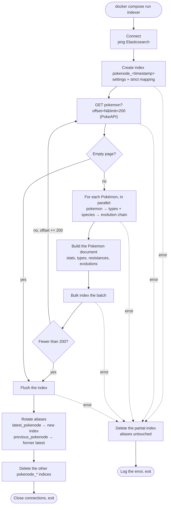

# Indexer

[English](#english) · [Français](#français) · [Project README](../README.md)



---

## English

The indexer is a one-shot Node.js worker that copies every Pokémon from [PokeAPI](https://pokeapi.co/api/v2) into Elasticsearch. It runs, builds a new index, switches the API to it, and exits. The [API](../backend/README.md) only reads the `latest_pokenode` alias that it maintains.

- [How it works](#how-it-works)
- [Run the indexer](#run-the-indexer)
- [Reference](#reference)
- [Design choices](#design-choices)

### How it works

The diagram above shows one run.

1. **Connect.** The Elasticsearch connector pings the cluster; the run stops if it is not reachable.
2. **Create the index.** A new index `pokenode_<timestamp>` is created with one shard, the analysis settings (autocomplete on the name, lowercase normalizer) and a strict mapping.
3. **Read PokeAPI.** The Pokémon list is read page by page, 200 at a time. For each Pokémon of a page, in parallel, the indexer fetches the Pokémon, its types and its species, then its evolution chain. Types, species and evolution chains are shared by many Pokémon: each one is requested once per run (see [PokeAPI calls](#pokeapi-calls)).
4. **Transform.** Each answer becomes a `Pokemon` document: base stats, types with their icon, generation, resistances to the 18 attacking types, direct evolutions and pre-evolution.
5. **Index.** Each page is sent in one bulk request, with the Pokémon id as document id. Any item error fails the run.
6. **Flush** the index once every page is written.
7. **Rotate the aliases** in one atomic request: `latest_pokenode` moves to the new index, `previous_pokenode` to the index that was `latest_pokenode`.
8. **Clean up.** Every other `pokenode_*` index is deleted. A failed deletion is logged as a warning and does not fail the run.

If a step from 2 to 6 fails, the partial index is deleted and the aliases are not touched: the API keeps serving the previous data.

### Run the indexer

#### With Docker Compose

From the root of the repository:

```sh
docker compose --profile indexing run --build --rm indexer
```

- `--profile indexing`: the `indexer` service is not started by `docker compose up`, it belongs to this profile.
- `--build`: rebuilds the image, so code changes are taken into account.
- `--rm`: removes the container once the run is over.

Compose starts `elasticsearch` first if needed and waits until it is healthy. The run takes a few minutes, writes JSON logs, and exits.

Check the result:

```sh
curl "http://localhost:9200/_cat/aliases/*_pokenode?v"
curl "http://localhost:9200/latest_pokenode/_count"
```

The first command lists `latest_pokenode` (and `previous_pokenode` after a second run); the second gives the number of indexed Pokémon.

Run the same command again to re-index: the API switches to the new data only once it is complete.

#### Without Docker

Requires Node.js 26 (see [.nvmrc](.nvmrc)) and a reachable Elasticsearch, for example:

```sh
docker compose up -d elasticsearch
```

Then, in `indexer/`:

```sh
npm install
POKE_API_URL=https://pokeapi.co/api/v2 npm run dev
```

`npm run dev` runs the TypeScript sources with `tsx`. To run the compiled version:

```sh
npm run build
POKE_API_URL=https://pokeapi.co/api/v2 npm start
```

You can also put the URLs in `config/local.json` (ignored by git) instead of environment variables:

```json
{
    "connectors": {
        "pokeApi": { "url": "https://pokeapi.co/api/v2" }
    }
}
```

#### Check the code

```sh
npm run test
npm run lint
npm run build
npm run prettier
```

### Reference

#### Configuration

Read with [`config`](https://github.com/node-config/node-config) from `config/default.json`, overridden by `config/local.json` and the environment variables below.

| Variable | Config key | Default | Description |
|---|---|---|---|
| `POKE_STORE_URL` | `connectors.pokeStore.url` | `http://localhost:9200` | Elasticsearch URL |
| `POKE_API_URL` | `connectors.pokeApi.url` | `http://pokemon-api-url` (placeholder) | PokeAPI URL, must be set to `https://pokeapi.co/api/v2` |
| `LOG_LEVEL` | none | `info` | `error`, `warn`, `info` or `debug` |

In Docker Compose, `POKE_STORE_URL=http://elasticsearch:9200` and `POKE_API_URL=https://pokeapi.co/api/v2` are set in [docker-compose.yml](../docker-compose.yml).

#### Indices and aliases

| Name | Kind | Description |
|---|---|---|
| `pokenode_<timestamp>` | index | One per run, `<timestamp>` in milliseconds |
| `latest_pokenode` | alias | Most recent complete index, read by the API |
| `previous_pokenode` | alias | Index that was `latest_pokenode` before the last run |

#### PokeAPI calls

| Request | When | Calls per run (measured 2026-11-23) |
|---|---|---|
| `GET pokemon?offset=N&limit=200` | Once per page | 7 |
| `GET pokemon/{id}` | Once per Pokémon | 1 351 |
| `GET type/{id}` | Once per distinct type | 18 |
| `GET pokemon-species/{id}` | Once per distinct species | 1 025 |
| `GET evolution-chain/{id}` | Once per distinct evolution chain | 540 |
| **Total** | | **2 941** |

Types, species and evolution chains go through `PokeResourceRepository`, which keeps the promise of each URL for the duration of the run:

- Pokémon of the same page that need the same resource at the same time share a single request;
- later pages get the answer already received, without a new call;
- a failed request is removed, so the next caller tries again;
- the cache is emptied when the list is exhausted or the run fails.

Without this cache, a run made 6 176 calls. The cache holds about 40 MB of heap during a run, mostly the species.

#### Indexed document

| Field | Type in Elasticsearch | Source |
|---|---|---|
| `id`, `pokedexId` | `integer` | Pokémon id |
| `name` | `text`, with `name.keyword` (lowercase) and `name.autocomplete` (edge n-grams 2 to 20) | Pokémon name |
| `slug` | `keyword`, lowercase | Pokémon name |
| `image` | `keyword`, not indexed | Official artwork |
| `sprite` | `keyword`, not indexed | Default sprite |
| `stats.HP`, `attack`, `defense`, `special_attack`, `special_defense`, `speed` | `integer` | Base stats |
| `apiTypes.name` | `keyword`, lowercase | Types, in slot order |
| `apiTypes.image` | `keyword`, not indexed | Type icon (Sword / Shield) |
| `apiGeneration` | `integer` | Species generation |
| `apiResistances` | stored, not indexed | Damage multiplier and relation for each of the 18 attacking types |
| `apiEvolutions` | stored, not indexed | Direct evolutions (`name`, `pokedexId`) |
| `apiPreEvolution` | stored, not indexed | Previous species name, or `none` |
| `resistanceModifyingAbilitiesForApi` | stored, not indexed | First ability (best effort, PokeAPI has no equivalent) |
| `apiResistancesWithAbilities` | stored, not indexed | Same as `apiResistances` (PokeAPI does not compute ability effects) |

The mapping is `dynamic: strict`: a document with an unknown field is rejected and fails the run.

Damage relations: `immune` (×0), `twice_resistant` (×0.25), `resistant` (×0.5), `neutral` (×1), `vulnerable` (×2), `twice_vulnerable` (×4).

#### Source layout

| Path | Layer | Role |
|---|---|---|
| `src/main.ts` | entry point | Opens the connectors, runs the indexation, closes the connectors |
| `src/connectors/PokeAPIConnector.ts` | connectors | `ky` client on the PokeAPI URL |
| `src/connectors/PokeStoreConnector.ts` | connectors | Elasticsearch client |
| `src/repositories/PokeRepository.ts` | repositories | Reads PokeAPI page by page, builds the `Pokemon` documents |
| `src/repositories/PokeResourceRepository.ts` | repositories | Shares the requests for types, species and evolution chains during a run |
| `src/repositories/PokeIndexRepository.ts` | repositories | Creates, fills, flushes and deletes indices, updates aliases |
| `src/services/PokemonIndexationService.ts` | services | Runs one indexation, deletes the partial index on failure |
| `src/services/AliasRotationService.ts` | services | Plans and applies the alias rotation and the cleanup |
| `src/services/mapping.ts`, `settings.ts` | services | Index mapping and analysis settings |
| `src/logger.ts` | | `winston` logger, JSON on the console |

### Design choices

**A new index per run.** Writing into a fresh index instead of updating the live one means the API never reads half-indexed data. The alias switch is atomic, so the API goes from the old data to the new one in a single step.

**Keep the previous index.** `previous_pokenode` keeps the former data for a rollback: pointing `latest_pokenode` back to it is one alias update. Only two indices are kept, so disk usage stays bounded.

**Fail the whole run.** A bulk error, a PokeAPI error or a mapping violation stops the run and deletes the partial index. A partial dataset would be served as if it were complete; keeping the old one is safer.

**Read PokeAPI once.** PokeAPI asks its clients to cache its answers. The indexer reads it in one pass, and the API never calls it at runtime.

**Request each shared resource once.** Many Pokémon share a type, a species or an evolution chain. The cache keeps the promise, not the answer: the 200 Pokémon of a page start at the same time, before any answer arrives, so caching answers alone would not help within a page. The cache only lives for one run, so each run still reads fresh data.

More context in [ADR-011](../ADR.md#adr-011--indexer-en-commonjs-et-image-docker-multi-stage), [ADR-012](../ADR.md#adr-012--rotation-des-alias-latest_pokenode--previous_pokenode), [ADR-013](../ADR.md#adr-013--client-http-unique-ky-via-le-connecteur-pokeapi) and [ADR-020](../ADR.md#adr-020--coalescence-des-requêtes-pokeapi-dans-pokeresourcerepository).

---

## Français

L'indexer est un worker Node.js ponctuel qui copie tous les Pokémon de [PokeAPI](https://pokeapi.co/api/v2) dans Elasticsearch. Il démarre, construit un nouvel index, y bascule l'API, puis s'arrête. L'[API](../backend/README.md) ne lit que l'alias `latest_pokenode` qu'il maintient.

- [Fonctionnement](#fonctionnement)
- [Lancer l'indexer](#lancer-lindexer)
- [Référence technique](#référence-technique)
- [Choix de conception](#choix-de-conception)

### Fonctionnement

Le schéma en haut de page montre une exécution.

1. **Connexion.** Le connecteur Elasticsearch ping le cluster ; l'exécution s'arrête s'il est injoignable.
2. **Création de l'index.** Un nouvel index `pokenode_<timestamp>` est créé avec un shard, les settings d'analyse (autocomplétion sur le nom, normalizer en minuscules) et un mapping strict.
3. **Lecture de PokeAPI.** La liste des Pokémon est lue page par page, 200 par 200. Pour chaque Pokémon d'une page, en parallèle, l'indexer récupère le Pokémon, ses types et son espèce, puis sa chaîne d'évolution. Les types, les espèces et les chaînes d'évolution sont communs à de nombreux Pokémon : chacun n'est demandé qu'une fois par exécution (voir [Appels à PokeAPI](#appels-à-pokeapi)).
4. **Transformation.** Chaque réponse devient un document `Pokemon` : statistiques de base, types avec leur icône, génération, résistances aux 18 types d'attaque, évolutions directes et pré-évolution.
5. **Indexation.** Chaque page est envoyée en une requête bulk, avec l'id du Pokémon comme id de document. La moindre erreur sur un élément fait échouer l'exécution.
6. **Flush** de l'index une fois toutes les pages écrites.
7. **Rotation des alias** en une requête atomique : `latest_pokenode` passe sur le nouvel index, `previous_pokenode` sur l'index qui portait `latest_pokenode`.
8. **Nettoyage.** Tous les autres index `pokenode_*` sont supprimés. Un échec de suppression est journalisé en warning et ne fait pas échouer l'exécution.

Si une étape de 2 à 6 échoue, l'index partiel est supprimé et les alias ne bougent pas : l'API continue de servir les données précédentes.

### Lancer l'indexer

#### Avec Docker Compose

Lancer l'indexation avec docker, depuis la racine du dépôt :

```sh
docker compose --profile indexing run --build --rm indexer
```

- `--profile indexing` : le service `indexer` n'est pas démarré par `docker compose up`, il appartient à ce profil.
- `--build` : reconstruit l'image, pour prendre en compte les modifications du code.
- `--rm` : supprime le conteneur à la fin de l'exécution.

Compose démarre d'abord `elasticsearch` si besoin et attend qu'il soit sain. L'exécution prend quelques minutes, écrit des logs JSON, puis s'arrête.

Vérifiez le résultat :

```sh
curl "http://localhost:9200/_cat/aliases/*_pokenode?v"
curl "http://localhost:9200/latest_pokenode/_count"
```

La première commande liste `latest_pokenode` (et `previous_pokenode` après une deuxième exécution) ; la seconde donne le nombre de Pokémon indexés.

Relancez la même commande pour réindexer : l'API ne bascule sur les nouvelles données qu'une fois celles-ci complètes.

#### Sans Docker

Nécessite Node.js 26 (voir [.nvmrc](.nvmrc)) et un Elasticsearch joignable, par exemple :

```sh
docker compose up -d elasticsearch
```

Puis, dans `indexer/` :

```sh
npm install
POKE_API_URL=https://pokeapi.co/api/v2 npm run dev
```

`npm run dev` exécute les sources TypeScript avec `tsx`. Pour exécuter la version compilée :

```sh
npm run build
POKE_API_URL=https://pokeapi.co/api/v2 npm start
```

Les URL peuvent aussi être placées dans `config/local.json` (ignoré par git) au lieu des variables d'environnement :

```json
{
    "connectors": {
        "pokeApi": { "url": "https://pokeapi.co/api/v2" }
    }
}
```

#### Vérifier le code

```sh
npm run test
npm run lint
npm run build
npm run prettier
```

### Référence technique

#### Configuration

Lue avec [`config`](https://github.com/node-config/node-config) depuis `config/default.json`, surchargée par `config/local.json` et par les variables d'environnement ci-dessous.

| Variable | Clé de config | Défaut | Description |
|---|---|---|---|
| `POKE_STORE_URL` | `connectors.pokeStore.url` | `http://localhost:9200` | URL d'Elasticsearch |
| `POKE_API_URL` | `connectors.pokeApi.url` | `http://pokemon-api-url` (valeur factice) | URL de PokeAPI, à définir à `https://pokeapi.co/api/v2` |
| `LOG_LEVEL` | aucune | `info` | `error`, `warn`, `info` ou `debug` |

Dans Docker Compose, `POKE_STORE_URL=http://elasticsearch:9200` et `POKE_API_URL=https://pokeapi.co/api/v2` sont définies dans [docker-compose.yml](../docker-compose.yml).

#### Index et alias

| Nom | Type | Description |
|---|---|---|
| `pokenode_<timestamp>` | index | Un par exécution, `<timestamp>` en millisecondes |
| `latest_pokenode` | alias | Index complet le plus récent, lu par l'API |
| `previous_pokenode` | alias | Index qui portait `latest_pokenode` avant la dernière exécution |

#### Appels à PokeAPI

| Requête | Quand | Appels par exécution (mesurés le 2026-11-23) |
|---|---|---|
| `GET pokemon?offset=N&limit=200` | Une fois par page | 7 |
| `GET pokemon/{id}` | Une fois par Pokémon | 1 351 |
| `GET type/{id}` | Une fois par type distinct | 18 |
| `GET pokemon-species/{id}` | Une fois par espèce distincte | 1 025 |
| `GET evolution-chain/{id}` | Une fois par chaîne d'évolution distincte | 540 |
| **Total** | | **2 941** |

Les types, les espèces et les chaînes d'évolution passent par `PokeResourceRepository`, qui garde la promesse de chaque URL pendant toute l'exécution :

- les Pokémon d'une même page qui demandent la même ressource au même moment partagent une seule requête ;
- les pages suivantes reçoivent la réponse déjà obtenue, sans nouvel appel ;
- une requête en échec est retirée du cache, et l'appel suivant la retente ;
- le cache est vidé à la fin de la liste ou quand l'exécution échoue.

Sans ce cache, une exécution faisait 6 176 appels. Le cache occupe environ 40 Mo de heap pendant une exécution, surtout pour les espèces.

#### Document indexé

| Champ | Type Elasticsearch | Source |
|---|---|---|
| `id`, `pokedexId` | `integer` | Id du Pokémon |
| `name` | `text`, avec `name.keyword` (minuscules) et `name.autocomplete` (edge n-grams de 2 à 20) | Nom du Pokémon |
| `slug` | `keyword`, minuscules | Nom du Pokémon |
| `image` | `keyword`, non indexé | Artwork officiel |
| `sprite` | `keyword`, non indexé | Sprite par défaut |
| `stats.HP`, `attack`, `defense`, `special_attack`, `special_defense`, `speed` | `integer` | Statistiques de base |
| `apiTypes.name` | `keyword`, minuscules | Types, dans l'ordre des slots |
| `apiTypes.image` | `keyword`, non indexé | Icône du type (Épée / Bouclier) |
| `apiGeneration` | `integer` | Génération de l'espèce |
| `apiResistances` | stocké, non indexé | Multiplicateur et relation de dégâts pour chacun des 18 types d'attaque |
| `apiEvolutions` | stocké, non indexé | Évolutions directes (`name`, `pokedexId`) |
| `apiPreEvolution` | stocké, non indexé | Nom de l'espèce précédente, ou `none` |
| `resistanceModifyingAbilitiesForApi` | stocké, non indexé | Premier talent (au mieux, PokeAPI n'a pas d'équivalent) |
| `apiResistancesWithAbilities` | stocké, non indexé | Identique à `apiResistances` (PokeAPI ne calcule pas l'effet des talents) |

Le mapping est en `dynamic: strict` : un document avec un champ inconnu est rejeté et fait échouer l'exécution.

Relations de dégâts : `immune` (×0), `twice_resistant` (×0,25), `resistant` (×0,5), `neutral` (×1), `vulnerable` (×2), `twice_vulnerable` (×4).

#### Organisation du code

| Chemin | Couche | Rôle |
|---|---|---|
| `src/main.ts` | point d'entrée | Ouvre les connecteurs, lance l'indexation, ferme les connecteurs |
| `src/connectors/PokeAPIConnector.ts` | connectors | Client `ky` sur l'URL de PokeAPI |
| `src/connectors/PokeStoreConnector.ts` | connectors | Client Elasticsearch |
| `src/repositories/PokeRepository.ts` | repositories | Lit PokeAPI page par page, construit les documents `Pokemon` |
| `src/repositories/PokeResourceRepository.ts` | repositories | Partage les requêtes de types, d'espèces et de chaînes d'évolution pendant une exécution |
| `src/repositories/PokeIndexRepository.ts` | repositories | Crée, remplit, flush et supprime les index, met à jour les alias |
| `src/services/PokemonIndexationService.ts` | services | Exécute une indexation, supprime l'index partiel en cas d'échec |
| `src/services/AliasRotationService.ts` | services | Planifie et applique la rotation des alias et le nettoyage |
| `src/services/mapping.ts`, `settings.ts` | services | Mapping et settings d'analyse de l'index |
| `src/logger.ts` | | Logger `winston`, JSON sur la console |

### Choix de conception

**Un nouvel index par exécution.** Écrire dans un index neuf plutôt que de mettre à jour l'index en service garantit que l'API ne lit jamais des données à moitié indexées. La bascule d'alias est atomique : l'API passe des anciennes données aux nouvelles en une seule étape.

**Garder l'index précédent.** `previous_pokenode` conserve les anciennes données pour un retour arrière : il suffit d'une mise à jour d'alias pour y repointer `latest_pokenode`. Seuls deux index sont conservés, l'espace disque reste borné.

**Faire échouer toute l'exécution.** Une erreur bulk, une erreur PokeAPI ou une violation du mapping arrête l'exécution et supprime l'index partiel. Un jeu de données partiel serait servi comme s'il était complet ; garder l'ancien est plus sûr.

**Lire PokeAPI une seule fois.** PokeAPI demande à ses clients de mettre ses réponses en cache. L'indexer la lit en une passe, et l'API ne l'appelle jamais à l'exécution.

**Demander une seule fois chaque ressource partagée.** De nombreux Pokémon partagent un type, une espèce ou une chaîne d'évolution. Le cache garde la promesse, pas la réponse : les 200 Pokémon d'une page démarrent en même temps, avant toute réponse, et un cache des seules réponses ne servirait à rien à l'intérieur d'une page. Le cache ne vit que le temps d'une exécution, donc chaque exécution relit des données à jour.

Plus de contexte dans [ADR-011](../ADR.md#adr-011--indexer-en-commonjs-et-image-docker-multi-stage), [ADR-012](../ADR.md#adr-012--rotation-des-alias-latest_pokenode--previous_pokenode), [ADR-013](../ADR.md#adr-013--client-http-unique-ky-via-le-connecteur-pokeapi) et [ADR-020](../ADR.md#adr-020--coalescence-des-requêtes-pokeapi-dans-pokeresourcerepository).
