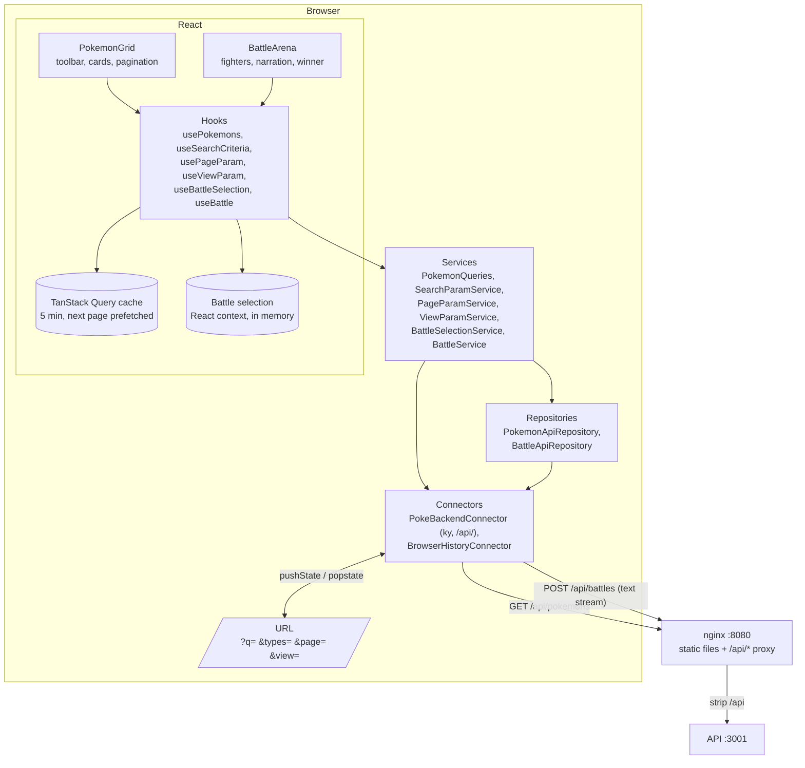

# Web app

[English](#english) · [Français](#français) · [Project README](../README.md)



---

## English

The web app is a React 18 single-page app in TypeScript. It shows the Pokémon served by the [API](../backend/README.md) in a grid, lets you search and filter them, and runs a battle between two of them, narrated live by the chatbot. Vite builds it; nginx serves it and proxies the API.

- [How it works](#how-it-works)
- [Run the web app](#run-the-web-app)
- [Reference](#reference)
- [Design choices](#design-choices)

### How it works

The diagram above shows the layers and the two calls to the API.

#### The Pokédex grid

1. The URL holds the state: `q` (name), `types` (one per type), `page`. `useSearchCriteria` and `usePageParam` read it through `BrowserHistoryConnector`, so the back and forward buttons work and a link can be shared.
2. `usePokemons` asks TanStack Query for the page. On a miss, `PokemonApiRepository` turns the page into `from` / `size` and calls `GET /api/pokemons`.
3. The answer becomes a `PokemonPage`: the Pokémon of the page, the total, and the type facets with their counts.
4. The grid shows 20 cards: number, name, type icons, artwork, and four stats (HP, Attack, Defense, Speed). While the page loads, skeleton cards are shown; when you change page, the previous page stays visible, dimmed, until the new one arrives.
5. The next page is prefetched in the background.

Searching resets the page to 1. The search is sent when you submit the form (Enter or **Search**), not on each key. The type filters come from the API facets, counted on the name search: ticking a type does not hide the others. Several types can be selected at once; a Pokémon matches if it has at least one of them.

#### The battle

1. **Add to battle** on a card adds the Pokémon to the selection (at most 2). A bar at the bottom of the page shows the fighters.
2. **Go to the arena** sets `?view=battle`. The arena replaces the grid.
3. **Start the battle** sends `POST /api/battles` with the two ids. The API answers with a plain-text stream.
4. `BattleApiRepository` decodes the stream chunk by chunk; `BattleService` turns the text received so far into a `BattleNarration`; the arena shows it as it grows.
5. When the stream ends, the narration line `VAINQUEUR: <name>` is removed from the text, the winner is matched to one of the fighters, and a banner shows them.

The narration line is matched without case, accents or Markdown decoration (`**Vainqueur :** Pikachu (#25)` works). Without this line, the arena shows "No winner was announced."

**Cancel** aborts the request; leaving the arena does too. On error, the arena shows a message for the error `code` returned by the API. On `429`, the **Retry** button stays disabled for the `Retry-After` delay.

The selection is kept in memory only: after a reload, the arena asks to pick 2 Pokémon again.

### Run the web app

#### With Docker Compose

From the root of the repository:

```sh
docker compose up -d --build web
```

Compose also starts `api` and `elasticsearch`. Open <http://localhost:5173>. The grid is empty until the Pokémon are indexed: see the [indexer](../indexer/README.md).

After a change in `web-app/`, rebuild only this service:

```sh
docker compose up -d --build web
```

#### With Vite (development)

Requires Node.js 26 (see [.nvmrc](.nvmrc)) and a running API on port `3001`, for example:

```sh
docker compose up -d api
docker compose stop web
```

Stopping `web` frees port `5173`. Then, in `web-app/`:

```sh
npm install
npm run dev
```

Open <http://localhost:5173>. Vite reloads the page on each change and proxies `/api/*` to the API. To use another API:

```sh
API_PROXY_TARGET=http://localhost:4000 npm run dev
```

To check the production build locally:

```sh
npm run build
npm run preview
```

`vite preview` serves `dist/` without the `/api` proxy of nginx, so API calls fail there; use Docker Compose to test the full build.

#### Check the code

```sh
npm run test
npm run lint
npm run build
npm run prettier
```

`npm run test:watch` runs the tests in watch mode.

### Reference

#### URL parameters

| Parameter | Values | Default | Description |
|---|---|---|---|
| `q` | text | none | Name search, trimmed |
| `types` | type name, repeatable | none | Type filters, `?types=fire&types=water` |
| `page` | integer ≥ 1 | `1` | Grid page; a page beyond the last one is replaced by the last one |
| `view` | `battle` | grid | Shows the arena |

#### API calls

| Call | Used by | Timeout | Answer |
|---|---|---|---|
| `GET /api/pokemons?from=&size=20&q=&types=` | Grid | 10 s | JSON `{ pokemons: { from, size, total, items, filters } }` |
| `POST /api/battles` `{ "pokemonIds": ["25", "6"] }` | Arena | 30 s before the first byte | `text/plain` stream, `X-Session-Id` header |

The base URL is `/api/`, relative to the page. Requests are not retried by `ky`; TanStack Query retries a failed grid request once.

#### Settings

| Setting | Value | Where |
|---|---|---|
| Page size | 20 | `PokemonApiRepository.DEFAULT_PAGE_SIZE` |
| Grid cache | fresh for 5 min, no refetch on window focus, 1 retry | `src/lib/queryClient.ts` |
| Fighters per battle | 2 | `BATTLE_SIZE` in `src/constants.ts` |
| Winner marker | `VAINQUEUR:` | `WINNER_MARKER` in `src/constants.ts` |
| Battle timeout | 30 000 ms | `BATTLE_TIMEOUT_MS` in `src/constants.ts` |
| API proxy target (dev) | `http://localhost:3001` | `API_PROXY_TARGET`, read by `vite.config.ts` |

#### Battle states

| Status | Meaning | Main button |
|---|---|---|
| `idle` | Nothing sent yet | **Start the battle** |
| `connecting` | Request sent, no text yet | **Cancel** |
| `streaming` | Narration arriving | **Cancel** |
| `done` | Stream ended, winner shown if found | **Fight again** |
| `error` | Request or stream failed | **Retry** |

#### Battle error messages

| Case | Message |
|---|---|
| `404` | Pokémon not found: *ids*. |
| `429` | The arena is busy, try again in *n* s. |
| `400` | This battle request is invalid. |
| Stream cut | The battle was interrupted. |
| Anything else (`502`, network…) | The battle could not take place. |

#### nginx

| Path | Behaviour |
|---|---|
| `/api/*` | Proxied to `http://api:3001/` without the `/api` prefix; buffering off (for the stream), 120 s read timeout |
| `/assets/*` | Cached 1 year, `immutable` (file names carry a hash) |
| `/index.html` | `no-cache` |
| anything else | Falls back to `index.html` |

Every response gets `X-Content-Type-Options: nosniff`, `X-Frame-Options: DENY` and `Referrer-Policy: strict-origin-when-cross-origin`. gzip is on for CSS, JS, JSON and SVG. The container listens on `8080` as a non-root user.

#### Source layout

| Path | Layer | Role |
|---|---|---|
| `src/connectors/PokeBackendConnector.ts` | connectors | `ky` client on `/api/`, JSON `get` and streaming `postStream` |
| `src/connectors/BrowserHistoryConnector.ts` | connectors | Reads and writes URL parameters, notifies on change |
| `src/repositories/PokemonApiRepository.ts` | repositories | Page → `from` / `size`, search parameters, `PokemonPage` |
| `src/repositories/BattleApiRepository.ts` | repositories | Starts the battle, decodes the stream, maps errors to `BattleError` |
| `src/services/PokemonQueries.ts` | services | TanStack Query keys and options |
| `src/services/SearchParamService.ts`, `PageParamService.ts`, `ViewParamService.ts` | services | Parse and write `q` / `types`, `page`, `view` |
| `src/services/PaginationService.ts` | services | Page numbers and ellipses of the pagination |
| `src/services/BattleSelectionService.ts` | services | Add, remove, limit the fighters |
| `src/services/BattleService.ts` | services | Builds the narration from the stream, finds the winner |
| `src/entities/` | entities | `Pokemon`, `PokemonStat`, `PokemonPage`, `PokemonTypeFacet`, `BattleNarration`, `BattleError` |
| `src/hooks/` | hooks | Bind services and state to React |
| `src/components/` | components | Header, theme switch, toolbar, grid, cards, pagination, battle bar and arena |
| `src/test/` | tests | Setup, fixtures, stream helpers |

Tests sit in `__tests__` folders next to the code. They use Vitest, Testing Library and jsdom.

### Design choices

**State in the URL.** Search, filters, page and view live in the URL, not in React state. A reload or a shared link shows the same screen, and the browser buttons navigate between searches. `useSyncExternalStore` keeps React in sync with the history.

**Server-side search and facets.** Filtering, pagination and type counts are done by the API in Elasticsearch. The browser only loads 20 Pokémon at a time, and the type filters always match the results.

**TanStack Query for the grid, not for the battle.** The grid is cached data: TanStack Query handles cache, previous page and prefetch. A battle is a one-off stream that must not be cached or replayed, so it uses a plain reducer and an `AbortController`.

**Relative API URL.** The front calls `/api/...`. nginx in Docker and Vite in development forward it to the API. The same build works everywhere, with no API URL baked in and no CORS setup.

**Accessibility.** Keyboard focus is visible, the grid announces its loading state (`aria-busy`), results and the winner are announced (`aria-live`, `role="status"`), errors use `role="alert"`, and the card tilt and smooth scrolling are turned off when the system asks for reduced motion.

More context in [ADR-001 to ADR-010](../ADR.md) and [ADR-016](../ADR.md#adr-016--arène-de-combat--lecture-du-stream-hors-tanstack-query).

---

## Français

L'application web est une application monopage React 18 en TypeScript. Elle affiche dans une grille les Pokémon servis par l'[API](../backend/README.md), permet de les rechercher et de les filtrer, et lance un combat entre deux d'entre eux, raconté en direct par le chatbot. Vite la construit ; nginx la sert et relaie l'API.

- [Principe de fonctionnement](#principe-de-fonctionnement)
- [Lancer l'application web](#lancer-lapplication-web)
- [Référence technique](#référence-technique)
- [Choix de conception](#choix-de-conception)

### Principe de fonctionnement

Le schéma en haut de page montre les couches et les deux appels à l'API.

#### La grille du Pokédex

1. L'URL porte l'état : `q` (nom), `types` (un par type), `page`. `useSearchCriteria` et `usePageParam` la lisent via `BrowserHistoryConnector` : les boutons précédent / suivant fonctionnent et un lien peut être partagé.
2. `usePokemons` demande la page à TanStack Query. Si elle n'est pas en cache, `PokemonApiRepository` convertit la page en `from` / `size` et appelle `GET /api/pokemons`.
3. La réponse devient un `PokemonPage` : les Pokémon de la page, le total, et les facettes de types avec leur nombre.
4. La grille affiche 20 cartes : numéro, nom, icônes des types, illustration et quatre statistiques (PV, Attaque, Défense, Vitesse). Pendant le chargement, des cartes squelettes s'affichent ; au changement de page, la page précédente reste visible, grisée, jusqu'à l'arrivée de la nouvelle.
5. La page suivante est préchargée en arrière-plan.

Une recherche remet la page à 1. Elle est envoyée à la validation du formulaire (Entrée ou **Search**), pas à chaque touche. Les filtres de type viennent des facettes de l'API, comptées sur la recherche par nom : cocher un type ne masque pas les autres. Plusieurs types peuvent être sélectionnés en même temps ; un Pokémon correspond s'il a au moins l'un d'eux.

#### Le combat

1. **Add to battle** sur une carte ajoute le Pokémon à la sélection (2 au maximum). Une barre en bas de page affiche les combattants.
2. **Go to the arena** ajoute `?view=battle`. L'arène remplace la grille.
3. **Start the battle** envoie `POST /api/battles` avec les deux ids. L'API répond par un stream de texte brut.
4. `BattleApiRepository` décode le stream morceau par morceau ; `BattleService` transforme le texte reçu en `BattleNarration` ; l'arène l'affiche au fur et à mesure.
5. À la fin du stream, la ligne `VAINQUEUR: <nom>` est retirée du texte, le vainqueur est rapproché d'un des combattants, et un bandeau l'affiche.

La ligne est reconnue sans tenir compte de la casse, des accents ni de la mise en forme Markdown (`**Vainqueur :** Pikachu (#25)` fonctionne). Sans cette ligne, l'arène affiche « No winner was announced. ».

**Cancel** annule la requête ; quitter l'arène aussi. En cas d'erreur, l'arène affiche un message selon le `code` d'erreur renvoyé par l'API. Sur un `429`, le bouton **Retry** reste désactivé pendant le délai `Retry-After`.

La sélection n'est gardée qu'en mémoire : après un rechargement, l'arène demande de choisir à nouveau 2 Pokémon.

### Lancer l'application web

#### Avec Docker Compose

Depuis la racine du dépôt :

```sh
docker compose up -d --build web
```

Compose démarre aussi `api` et `elasticsearch`. Ouvrez <http://localhost:5173>. La grille reste vide tant que les Pokémon ne sont pas indexés : voir l'[indexer](../indexer/README.md).

Après une modification dans `web-app/`, reconstruisez uniquement ce service :

```sh
docker compose up -d --build web
```

#### Avec Vite (développement)

Nécessite Node.js 26 (voir [.nvmrc](.nvmrc)) et une API démarrée sur le port `3001`, par exemple :

```sh
docker compose up -d api
docker compose stop web
```

Arrêter `web` libère le port `5173`. Puis, dans `web-app/` :

```sh
npm install
npm run dev
```

Ouvrez <http://localhost:5173>. Vite recharge la page à chaque modification et relaie `/api/*` vers l'API. Pour utiliser une autre API :

```sh
API_PROXY_TARGET=http://localhost:4000 npm run dev
```

Pour vérifier le build de production en local :

```sh
npm run build
npm run preview
```

`vite preview` sert `dist/` sans le proxy `/api` de nginx : les appels à l'API y échouent. Utilisez Docker Compose pour tester le build complet.

#### Vérifier le code

```sh
npm run test
npm run lint
npm run build
npm run prettier
```

`npm run test:watch` lance les tests en mode watch.

### Référence technique

#### Paramètres d'URL

| Paramètre | Valeurs | Défaut | Description |
|---|---|---|---|
| `q` | texte | aucun | Recherche par nom, sans espaces autour |
| `types` | nom de type, répétable | aucun | Filtres de type, `?types=fire&types=water` |
| `page` | entier ≥ 1 | `1` | Page de la grille ; une page au-delà de la dernière est remplacée par la dernière |
| `view` | `battle` | grille | Affiche l'arène |

#### Appels à l'API

| Appel | Utilisé par | Timeout | Réponse |
|---|---|---|---|
| `GET /api/pokemons?from=&size=20&q=&types=` | Grille | 10 s | JSON `{ pokemons: { from, size, total, items, filters } }` |
| `POST /api/battles` `{ "pokemonIds": ["25", "6"] }` | Arène | 30 s avant le premier octet | Stream `text/plain`, en-tête `X-Session-Id` |

L'URL de base est `/api/`, relative à la page. `ky` ne relance pas les requêtes ; TanStack Query relance une fois une requête de grille en échec.

#### Réglages

| Réglage | Valeur | Emplacement |
|---|---|---|
| Taille de page | 20 | `PokemonApiRepository.DEFAULT_PAGE_SIZE` |
| Cache de la grille | frais 5 min, pas de rechargement au focus, 1 nouvelle tentative | `src/lib/queryClient.ts` |
| Combattants par combat | 2 | `BATTLE_SIZE` dans `src/constants.ts` |
| Marqueur du vainqueur | `VAINQUEUR:` | `WINNER_MARKER` dans `src/constants.ts` |
| Timeout du combat | 30 000 ms | `BATTLE_TIMEOUT_MS` dans `src/constants.ts` |
| Cible du proxy API (dev) | `http://localhost:3001` | `API_PROXY_TARGET`, lue par `vite.config.ts` |

#### États du combat

| Statut | Signification | Bouton principal |
|---|---|---|
| `idle` | Rien n'a été envoyé | **Start the battle** |
| `connecting` | Requête envoyée, pas encore de texte | **Cancel** |
| `streaming` | La narration arrive | **Cancel** |
| `done` | Stream terminé, vainqueur affiché s'il est trouvé | **Fight again** |
| `error` | Échec de la requête ou du stream | **Retry** |

#### Messages d'erreur du combat

| Cas | Message |
|---|---|
| `404` | Pokémon not found: *ids*. |
| `429` | The arena is busy, try again in *n* s. |
| `400` | This battle request is invalid. |
| Stream coupé | The battle was interrupted. |
| Autre (`502`, réseau…) | The battle could not take place. |

#### nginx

| Chemin | Comportement |
|---|---|
| `/api/*` | Relayé vers `http://api:3001/` sans le préfixe `/api` ; buffering désactivé (pour le stream), timeout de lecture de 120 s |
| `/assets/*` | Cache d'un an, `immutable` (les noms de fichiers contiennent un hash) |
| `/index.html` | `no-cache` |
| tout le reste | Renvoie `index.html` |

Chaque réponse porte `X-Content-Type-Options: nosniff`, `X-Frame-Options: DENY` et `Referrer-Policy: strict-origin-when-cross-origin`. gzip est activé pour le CSS, le JS, le JSON et le SVG. Le conteneur écoute sur `8080` avec un utilisateur non root.

#### Organisation du code

| Chemin | Couche | Rôle |
|---|---|---|
| `src/connectors/PokeBackendConnector.ts` | connectors | Client `ky` sur `/api/`, `get` JSON et `postStream` en streaming |
| `src/connectors/BrowserHistoryConnector.ts` | connectors | Lit et écrit les paramètres d'URL, notifie les changements |
| `src/repositories/PokemonApiRepository.ts` | repositories | Page → `from` / `size`, paramètres de recherche, `PokemonPage` |
| `src/repositories/BattleApiRepository.ts` | repositories | Lance le combat, décode le stream, convertit les erreurs en `BattleError` |
| `src/services/PokemonQueries.ts` | services | Clés et options TanStack Query |
| `src/services/SearchParamService.ts`, `PageParamService.ts`, `ViewParamService.ts` | services | Lecture et écriture de `q` / `types`, `page`, `view` |
| `src/services/PaginationService.ts` | services | Numéros de page et ellipses de la pagination |
| `src/services/BattleSelectionService.ts` | services | Ajout, retrait et limite des combattants |
| `src/services/BattleService.ts` | services | Construit la narration à partir du stream, trouve le vainqueur |
| `src/entities/` | entités | `Pokemon`, `PokemonStat`, `PokemonPage`, `PokemonTypeFacet`, `BattleNarration`, `BattleError` |
| `src/hooks/` | hooks | Relient les services et l'état à React |
| `src/components/` | composants | En-tête, bascule de thème, barre d'outils, grille, cartes, pagination, barre et arène de combat |
| `src/test/` | tests | Setup, fixtures, utilitaires de stream |

Les tests sont dans des dossiers `__tests__` à côté du code. Ils utilisent Vitest, Testing Library et jsdom.

### Choix de conception

**L'état dans l'URL.** La recherche, les filtres, la page et la vue vivent dans l'URL, pas dans l'état React. Un rechargement ou un lien partagé affiche le même écran, et les boutons du navigateur passent d'une recherche à l'autre. `useSyncExternalStore` garde React synchronisé avec l'historique.

**Recherche et facettes côté serveur.** Le filtrage, la pagination et le décompte par type sont faits par l'API dans Elasticsearch. Le navigateur ne charge que 20 Pokémon à la fois, et les filtres de type correspondent toujours aux résultats.

**TanStack Query pour la grille, pas pour le combat.** La grille, ce sont des données à mettre en cache : TanStack Query gère le cache, la page précédente et le préchargement. Un combat est un stream ponctuel qui ne doit être ni mis en cache ni rejoué : il passe par un simple reducer et un `AbortController`.

**URL d'API relative.** Le front appelle `/api/...`. nginx dans Docker et Vite en développement la relaient vers l'API. Le même build fonctionne partout, sans URL d'API figée et sans configuration CORS.

**Accessibilité.** Le focus clavier est visible, la grille annonce son chargement (`aria-busy`), les résultats et le vainqueur sont annoncés (`aria-live`, `role="status"`), les erreurs utilisent `role="alert"`, et l'inclinaison des cartes et le défilement animé sont désactivés quand le système demande moins d'animations.

Plus de contexte dans [ADR-001 à ADR-010](../ADR.md) et [ADR-016](../ADR.md#adr-016--arène-de-combat--lecture-du-stream-hors-tanstack-query).
